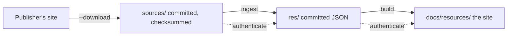
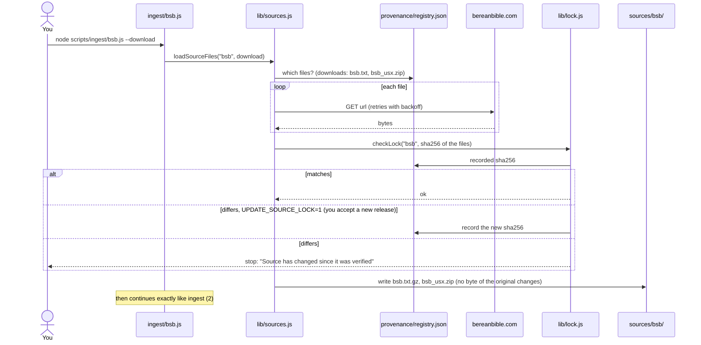
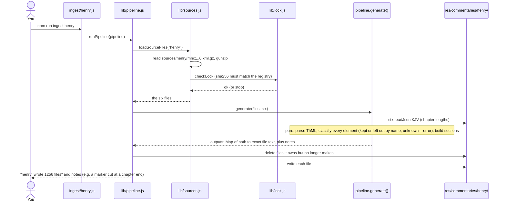
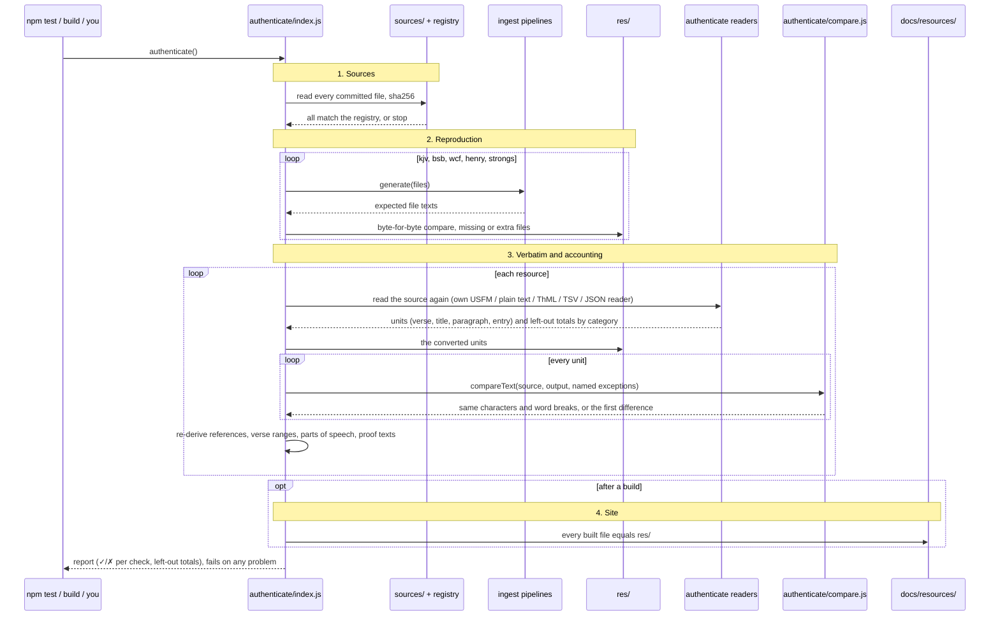
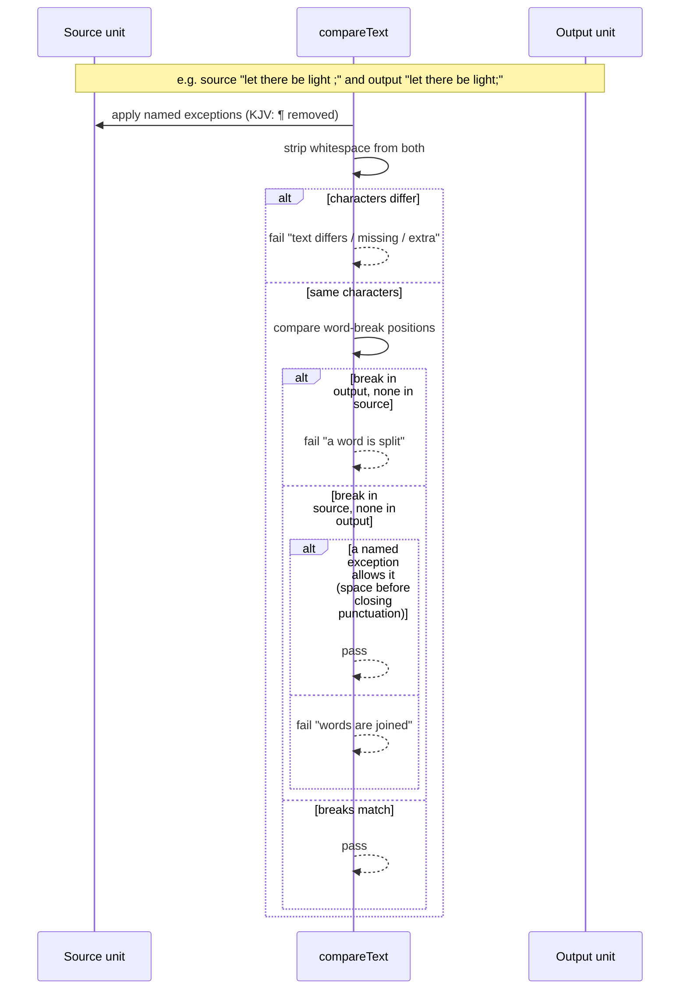

# Content pipeline: download, ingest, authenticate

How a publisher's file becomes text in the app, and how the repository proves nothing changed along the way. Each diagram follows the real calls; file names are under `scripts/`.

## 1. Download: taking a publisher's file

Only when you ask for it (`node scripts/ingest/bsb.js --download`). Everything else works offline from `sources/`.

## 2. Ingest: converting `sources/` into `res/`

`npm run ingest` runs this for every resource (KJV, BSB, WCF, Henry, Strong's), then validation and authentication.

## 3. Authenticate: proving `res/` is the sources' text

`npm run authenticate`, also inside `npm test` and every `npm run build`. The readers in `authenticate/` are separate code from the converters, so a converter bug can't hide itself.

## 4. One unit: what "verbatim" means

## Where each step runs

| Command | Download | Ingest | Authenticate |
|---|---|---|---|
| `node scripts/ingest/<id>.js --download` | yes | yes | no |
| `npm run ingest` | no | all five | yes |
| `npm run authenticate` | no | no (regenerates in memory only) | yes |
| `npm test` | no | no | yes, plus tamper and unit tests, 99% coverage floor |
| `npm run build` | no | no | yes, including the built site |

See [res/SOURCES.md](res/SOURCES.md#authentication) for the exceptions and categories in full.
